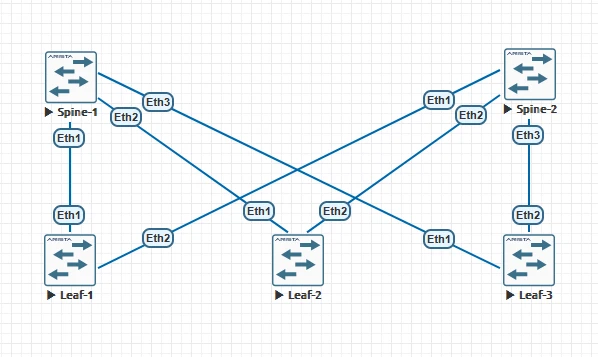
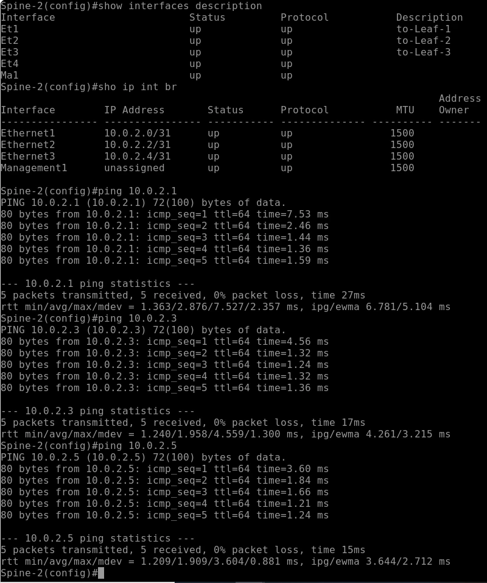
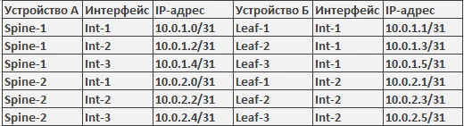
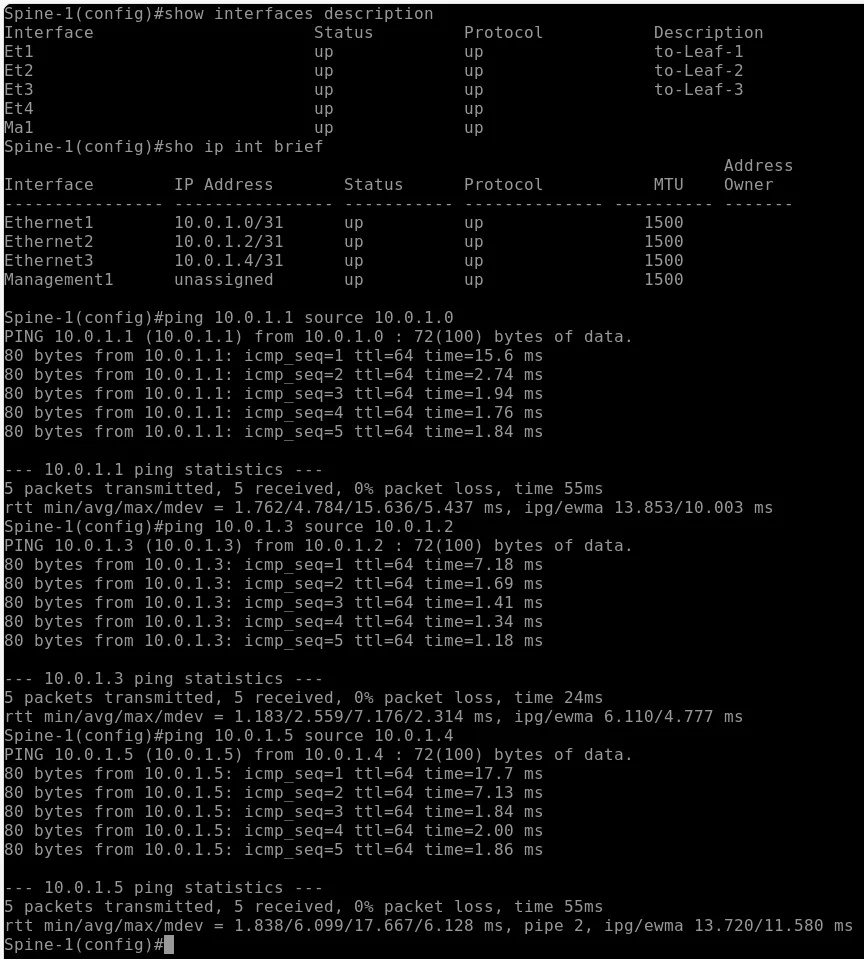

# Домашняя работа №1
## Проектирование адресного пространства

**Цель:**  
Собрать схему CLOS и распределить адресное пространство.

В EVE-NG была собрана лабораторная работа из 5 коммутаторов ARISTA.

Были назначены адреса интерфейсов. Маска `/31` была выбрана просто потому, что ранее никогда не использовалась в работе/учебе — хотелось попробовать (заранее известно, что коммутаторы поддерживают их).

### Схема лабораторной работы

<div align="center">
  
  <br>
  <i>Рис. 1. Топология сети</i>
</div>

<br>

### Таблица адресации


<br>

### Пример настройки интерфейсов (Spine-1)

```bash
!
interface Ethernet1
   description to-Leaf-1
   no switchport
   ip address 10.0.1.0/31
!
interface Ethernet2
   description to-Leaf-2
   no switchport
   ip address 10.0.1.2/31
!
interface Ethernet3
   description to-Leaf-3
   no switchport
   ip address 10.0.1.4/31
!

После настройки интерфейсов была проведена проверка ping'ом связанности.



