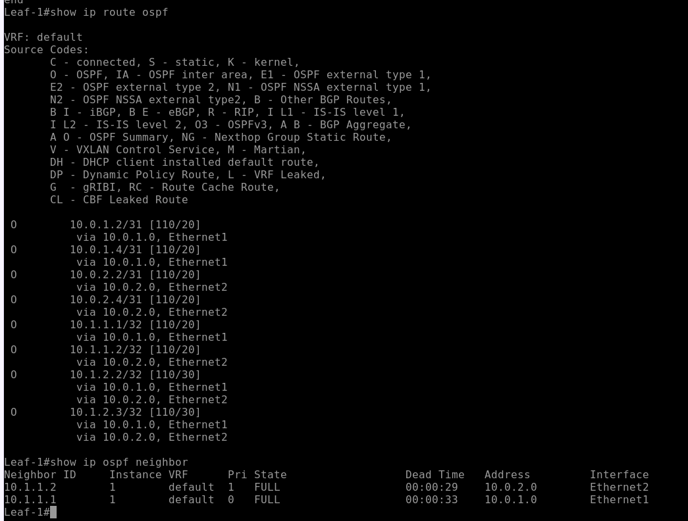
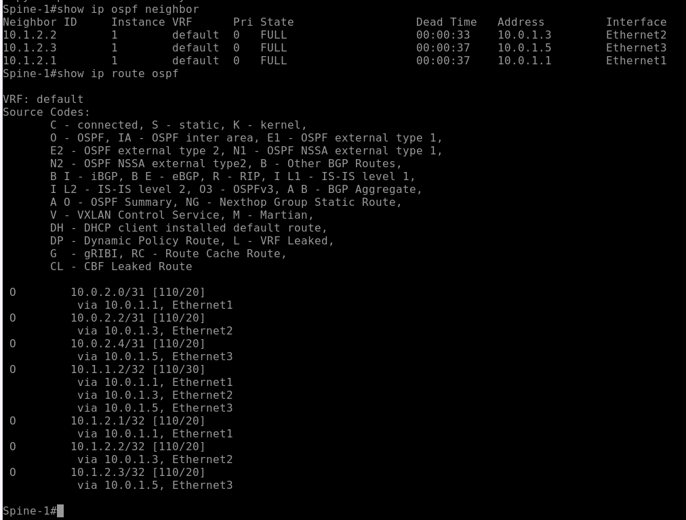
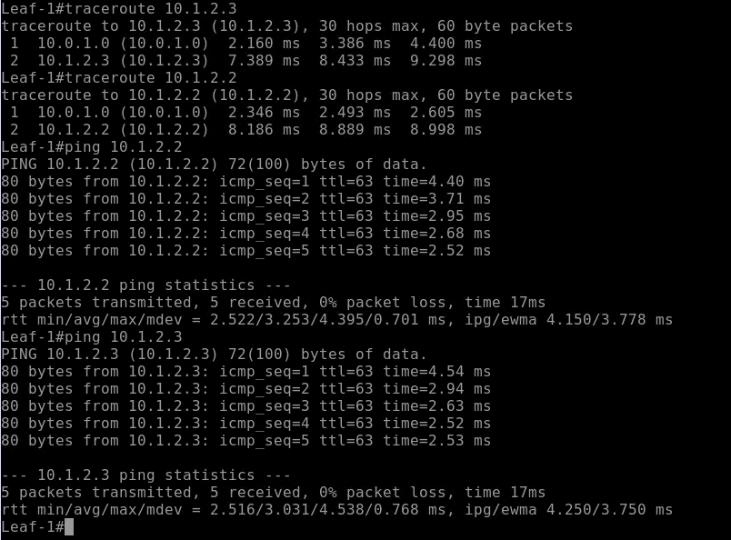

# Домашнее задание №2
## Underlay. OSPF

**Цель:**  
Настроить OSPF для Underlay сети.

### План работ:
1. Настроить OSPF в Underlay сети для IP-связности между всеми сетевыми устройствами.
2. Добавить BFD для проверки.
3. Убедиться в наличии IP-связности между устройствами в OSPF-домене.

### Конфигурация устройств

#### Пример настройки OSPF-процесса (Spine-1)

```bash
router ospf 1
   router-id 10.1.1.1
   max-lsa 12000
```

#### Настройка Loopback-интерфейса (Spine-1)

```bash
interface Loopback1
   ip address 10.1.1.1/32
   ip ospf area 0.0.0.0
```

#### Настройка физического интерфейса (пример для Spine-1)

```bash
interface Ethernet1
   description to-Leaf-1
   no switchport
   ip address 10.0.1.0/31
   ip ospf neighbor bfd
   ip ospf network point-to-point
   ip ospf area 0.0.0.0
```

#### Скриншоты проверок:
<div align="center">
  
  <br>
  <i>Рис. 1.</i>
</div>
<div align="center">
  
  <br>
  <i>Рис. 2.</i>
</div>

#### Проверка Ping+Traceroute с Leaf-1 к Leaf-2, Leaf-3:

<div align="center">
  
  <br>
  <i>Рис. 3.</i>
</div>
