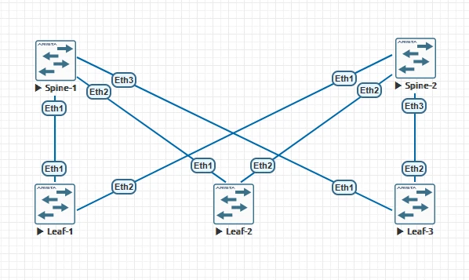
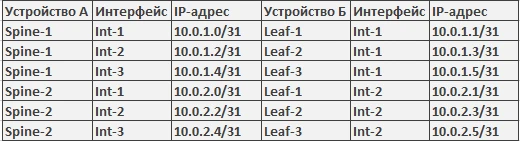

# Домашняя работа №3
## Underlay. IS-IS

**Цель:**  
настроить IS-IS для Underlay сети.

### План работ:

Настроите ISIS в Underlay сети, для IP связанности между всеми сетевыми устройствами.
Зафиксируете в документации - план работы, адресное пространство, схему сети, конфигурацию устройств
Убедитесь в наличии IP связанности между устройствами в ISIS домене

<div align="center">
  
  <br>
  <i>Рис. 1. Топология сети</i>
</div>

<br>

### Таблица адресации


<br>

### Пример настройки устройств
## Spine-1

```bash
router isis 1
   net 49.0001.0010.0001.0001.0001.00
   router-id ipv4 10.1.1.1
   is-type level-2
   log-adjacency-changes
   !
   address-family ipv4 unicast
```

```bash
interface Ethernet1
   description to-Leaf-1
   no switchport
   ip address 10.0.1.0/31
   isis enable 1
   isis network point-to-point
```
```bash
interface Loopback1
   ip address 10.1.1.1/32
   isis enable 1
```

После настройки интерфейсов была проведена проверка связанности ping'ом .


