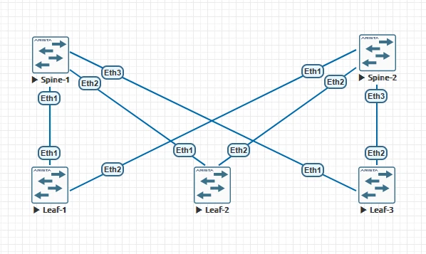
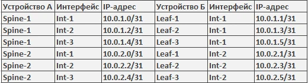

# Домашняя работа №3
## eBGP.

**Цель:**  
построение Underlay сети с использованием eBGP.

### План работ:

Настроить eBGP в Underlay сети, для IP связанности между всеми сетевыми устройствами.
Убедитесь в наличии IP связанности между устройствами в BGP домене

<div align="center">
  
  <br>
  <i>Рис. 1. Топология сети</i>
</div>

<br>

### Таблица адресации


<br>

| Устройство | Адрес Loopback |
|------------|----------------|
| Spine-1    | 10.1.1.1       |
| Spine-2    | 10.1.1.2       |
| Leaf-1     | 10.1.2.1       |
| Leaf-2     | 10.1.2.2       |
| Leaf-3     | 10.1.2.3       |

| Устройство | AS     |
|------------|--------|
| Spine-1    | 65110  |
| Spine-2    | 65110  |
| Leaf-1     | 65121  |
| Leaf-2     | 65122  |
| Leaf-3     | 65123  |

### Пример настройки устройств
## Spine-1

```bash
router bgp 65110
   router-id 10.1.1.1
   maximum-paths 3 ecmp 3
   bgp listen range 10.0.0.0/8 peer-group LEAFS peer-filter Filter-AS
   neighbor LEAFS peer group
   neighbor LEAFS bfd
   neighbor LEAFS timers 1 3
   !
   address-family ipv4
      neighbor LEAFS activate
      redistribute connected route-map RM-1
```

```bash
route-map RM-1 permit 10
   match interface Loopback1
   set origin incomplete
```
```bash
peer-filter Filter-AS
   10 match as-range 65120-65130 result accept
```

После настройки интерфейсов была проведена проверка связанности ping'ом .


# P.S. Изначально настраивал редистрибьюцию с ограничениями (route-map) но так и не понял какие минусы от фулл-редистр коннектед маршрутов, помимо того что адреса интерфейсов между лиф-спайнами передаются. 
