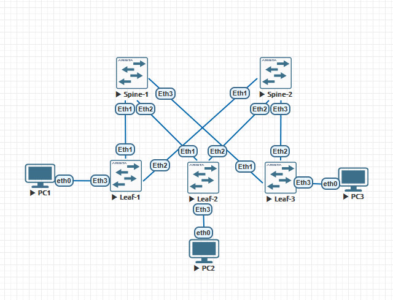
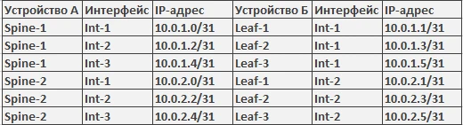
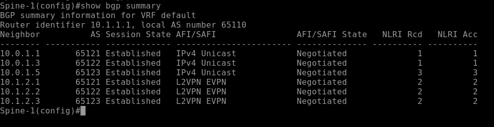
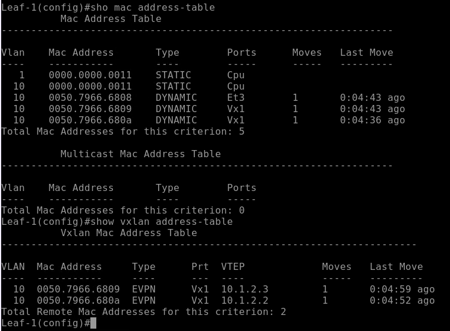
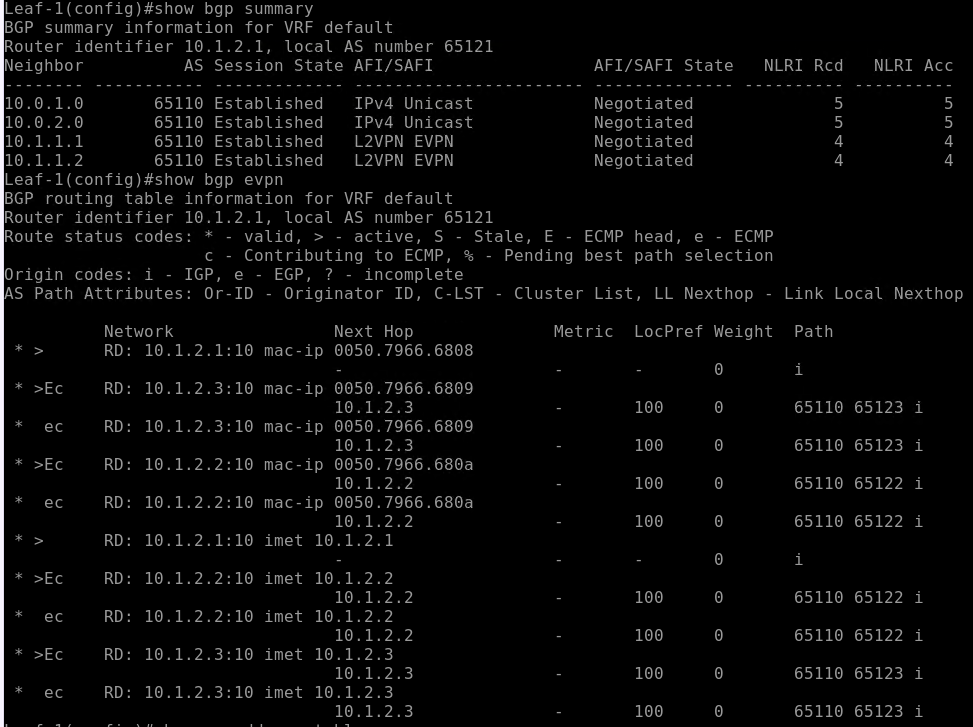
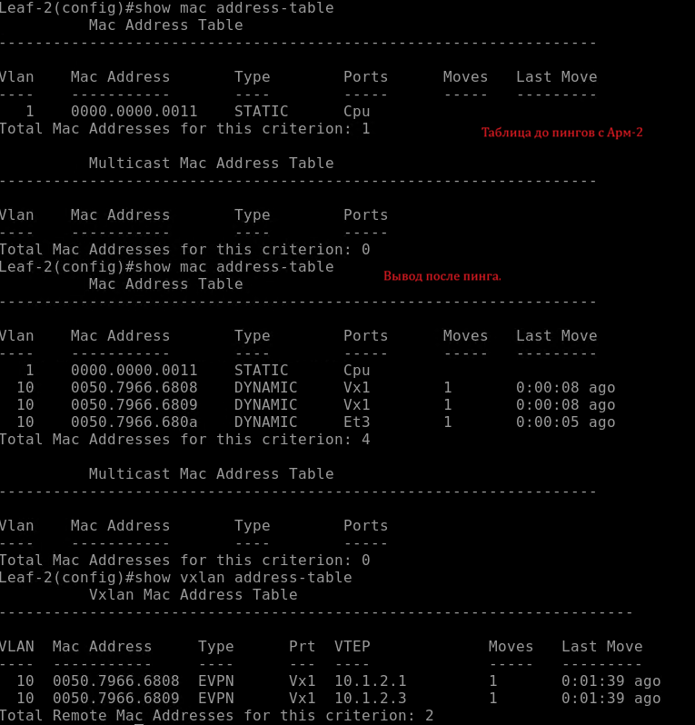
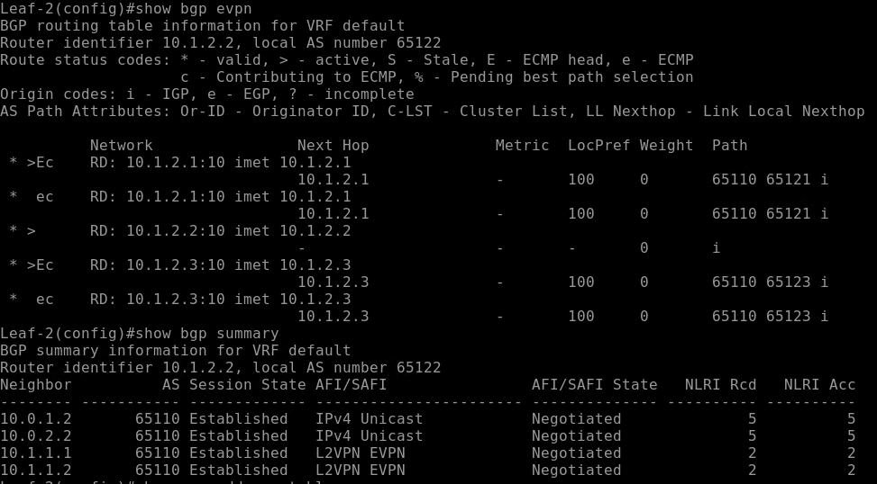

# Домашняя работа №5
## VxLAN. L2 VNI

**Цель:**  
Настроить Overlay на основе VxLAN EVPN для L2 связанности между клиентами.

### План работ:

Настроите BGP peering между Leaf и Spine в AF l2vpn evpn
Настроите связанность между клиентами в первой зоне и убедитесь в её наличии

<div align="center">
  
  <br>
  <i>Рис. 1. Топология сети</i>
</div>

<br>

### Таблица адресации


<br>

| Устройство | Адрес Loopback |
|------------|----------------|
| Spine-1    | 10.1.1.1       |
| Spine-2    | 10.1.1.2       |
| Leaf-1     | 10.1.2.1       |
| Leaf-2     | 10.1.2.2       |
| Leaf-3     | 10.1.2.3       |

| Устройство | AS     |
|------------|--------|
| Spine-1    | 65110  |
| Spine-2    | 65110  |
| Leaf-1     | 65121  |
| Leaf-2     | 65122  |
| Leaf-3     | 65123  |

## Настроена Overlay связанность между Lo интерфейсами устройств. Так же возвращена route-map на leaf'ах в редистребьюции маршрутов underley'я

### Пример Spine-1
```bash
router bgp 65110
   router-id 10.1.1.1
   no bgp default ipv4-unicast
   maximum-paths 3 ecmp 3
   bgp listen range 10.0.1.0/24 peer-group LEAFS peer-filter Filter-AS
   bgp listen range 10.1.2.0/24 peer-group LEAFS-LO peer-filter Filter-AS
   neighbor LEAFS peer group
   neighbor LEAFS bfd
   neighbor LEAFS timers 1 3
   neighbor LEAFS-LO peer group
   neighbor LEAFS-LO update-source Loopback1
   neighbor LEAFS-LO ebgp-multihop 5
   neighbor LEAFS-LO send-community extended
   !
   address-family evpn
      neighbor LEAFS-LO activate
      neighbor LEAFS-LO next-hop-unchanged
   !
   address-family ipv4
      neighbor LEAFS activate
      redistribute connected route-map RM-1
```
### Пример Leaf-1
```bash
!
router bgp 65121
   router-id 10.1.2.1
   no bgp default ipv4-unicast
   maximum-paths 3 ecmp 3
   neighbor SPINES peer group
   neighbor SPINES remote-as 65110
   neighbor SPINES bfd
   neighbor SPINES timers 1 3
   neighbor SPINES-LO peer group
   neighbor SPINES-LO remote-as 65110
   neighbor SPINES-LO update-source Loopback1
   neighbor SPINES-LO ebgp-multihop 3
   neighbor SPINES-LO send-community extended
   neighbor 10.0.1.0 peer group SPINES
   neighbor 10.0.2.0 peer group SPINES
   neighbor 10.1.1.1 peer group SPINES-LO
   neighbor 10.1.1.2 peer group SPINES-LO
   !
   vlan 10
      rd 10.1.2.1:10
      route-target both 10010:10010
      redistribute learned
   !
   address-family evpn
      neighbor SPINES-LO activate
   !
   address-family ipv4
      neighbor SPINES activate
      redistribute connected route-map RM-1
!
```
На Leaf устройствах добавлены вланы и влан интерфейсы и так же настроен виртуал мак адрес. Так же добавлен vxlan интерфейс и настроено сапостовление между Vlan10 и vni 10010.
```bash
!
vlan 10
   name Subs
!
interface Vlan10
   description SUBS
!
interface Vxlan1
   vxlan source-interface Loopback1
   vxlan udp-port 4789
   vxlan vlan 10 vni 10010
```

После настройки интерфейсов была проведена проверка связанности ping'ом.

| Устройство | Подсеть ПК     | IP-адрес ПК   |
|------------|----------------|---------------|
| Leaf-1     | 192.168.1.0/24 | 192.168.1.2   | 
| Leaf-2     | 192.168.1.0/24 | 192.168.1.3   | 
| Leaf-3     | 192.168.1.0/24 | 192.168.1.4   | 


## Скриншоты проверок на устройствах:
### Spine:  <br>
  <br>
### Leaf-1:  <br>
  <br>
  <br>
### Leaf-2:  <br>
  <br>
  <br>
