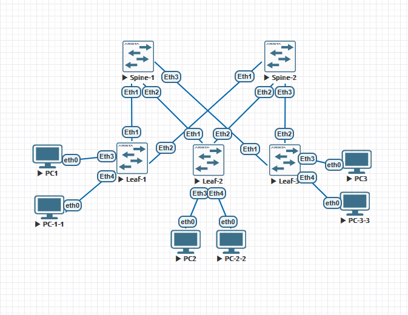
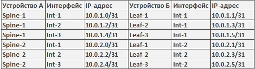

# Домашняя работа №5
## VxLAN. L3VNI

**Цель:**  
Настроить маршрутизацию в рамках Overlay между клиентами.

### План работ:

Настроите каждого клиента в своем VNI
Настроите маршрутизацию между клиентами.

<div align="center">
  
  <br>
  <i>Рис. 1. Топология сети</i>
</div>

<br>

### Таблица адресации


<br>

| Устройство | Адрес Loopback |
|------------|----------------|
| Spine-1    | 10.1.1.1       |
| Spine-2    | 10.1.1.2       |
| Leaf-1     | 10.1.2.1       |
| Leaf-2     | 10.1.2.2       |
| Leaf-3     | 10.1.2.3       |

| Устройство | AS     |
|------------|--------|
| Spine-1    | 65110  |
| Spine-2    | 65110  |
| Leaf-1     | 65121  |
| Leaf-2     | 65122  |
| Leaf-3     | 65123  |

## На каждый из Leaf'ов добавлен VRF, настроен для этого vrf vni, так же добавлены адреса интерфейсов, и vlan 20.

### Пример Leaf-1
Интерфейс добавлен в vrf и настроен virtual ip 
```bash
interface Vlan10
   description SUBS
   vrf SUBS
   ip address virtual 192.168.1.1/24
```
Настроено сапостовление vrf SUBS vni 10100
```bash
interface Vxlan1
   vxlan source-interface Loopback1
   vxlan udp-port 4789
   vxlan vlan 10 vni 10010
   vxlan vlan 20 vni 10020
   vxlan vrf SUBS vni 10100
```
Так же произведены настройки bgp 
```bash
router bgp 65121
   router-id 10.1.2.1
   no bgp default ipv4-unicast
   maximum-paths 3 ecmp 3
   neighbor SPINES peer group
   neighbor SPINES remote-as 65110
   neighbor SPINES bfd
   neighbor SPINES timers 1 3
   neighbor SPINES-LO peer group
   neighbor SPINES-LO remote-as 65110
   neighbor SPINES-LO update-source Loopback1
   neighbor SPINES-LO ebgp-multihop 3
   neighbor SPINES-LO send-community extended
   neighbor 10.0.1.0 peer group SPINES
   neighbor 10.0.2.0 peer group SPINES
   neighbor 10.1.1.1 peer group SPINES-LO
   neighbor 10.1.1.2 peer group SPINES-LO
   !
   vlan 10
      rd 10.1.2.1:10
      route-target both 10010:10010
      redistribute learned
   !
   vlan 20
      rd 10.1.2.1:20
      route-target both 10020:10020
      redistribute learned
   !
   address-family evpn
      neighbor SPINES-LO activate
   !
   address-family ipv4
      neighbor SPINES activate
      redistribute connected route-map RM-1
   !
   vrf SUBS
      rd 10.1.2.1:10100
      route-target import evpn 10100:10100
      route-target export evpn 10100:10100
      redistribute connected
```

После настройки интерфейсов PC была проведена проверка связанности ping'ом.

| Устройство | Подсеть ПК     | IP-адрес ПК   | Имя ПК   | VLAN  |
|------------|----------------|---------------|----------|-------|
| Leaf-1     | 192.168.1.0/24 | 192.168.1.2   | PC-1     |   10  |
| Leaf-1     | 192.168.2.0/24 | 192.168.2.2   | PC-1-1   |   20  |
| Leaf-2     | 192.168.1.0/24 | 192.168.1.3   | PC-2     |   10  |
| Leaf-2     | 192.168.2.0/24 | 192.168.2.3   | PC-2-2   |   20  |
| Leaf-3     | 192.168.1.0/24 | 192.168.1.4   | PC-3     |   10  |
| Leaf-3     | 192.168.2.0/24 | 192.168.2.4   | PC-3-3   |   20  |


## Скриншоты проверок на устройствах:
### Spine:  <br>
  <br>
### Leaf-1:  <br>
  <br>
  <br>
### Leaf-2:  <br>
  <br>
  <br>

