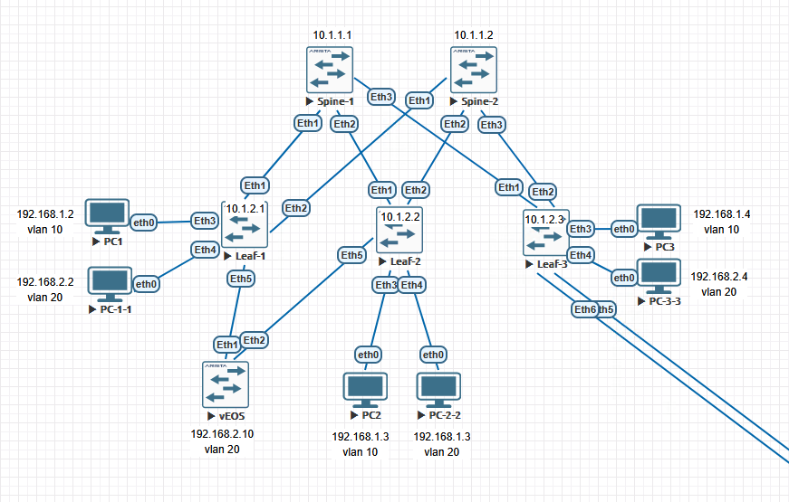
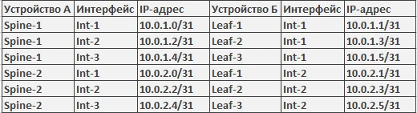

# Домашняя работа №5
## VXLAN. Multihoming

**Цель:**  
Настроить отказоустойчивое подключение клиентов с использованием EVPN Multihoming.
### План работ:
1. Подключите клиентов 2-я линками к различным Leaf
2. Настроите агрегированный канал со стороны клиента
3. Настроите multihoming для работы в Overlay сети. 

<div align="center">
  
  <br>
  <i>Рис. 1. Топология сети</i>
</div>

<br>

### Таблица адресации


<br>

| Устройство | Адрес Loopback |
|------------|----------------|
| Spine-1    | 10.1.1.1       |
| Spine-2    | 10.1.1.2       |
| Leaf-1     | 10.1.2.1       |
| Leaf-2     | 10.1.2.2       |
| Leaf-3     | 10.1.2.3       |

| Устройство | AS     |
|------------|--------|
| Spine-1    | 65110  |
| Spine-2    | 65110  |
| Leaf-1     | 65121  |
| Leaf-2     | 65122  |
| Leaf-3     | 65123  |

## Добавлено устройство HOST-1 и его интерфейсы настроены в Port-channel 

```bash
interface Port-Channel1
   description po-to-leafs
   switchport mode trunk
!
interface Ethernet1
   description -to-leaf-1-et5
   switchport mode trunk
   channel-group 1 mode active
!
interface Ethernet2
   description -to-leaf-2-et5
   switchport mode trunk
   channel-group 1 mode active
!
```
## На leaf-1 и leaf-2 интерфейсы связанные с HOST-1 так же настроены в port-chanel
Leaf-1
```bash
interface Ethernet5
   description link-to-Host
   switchport mode trunk
   channel-group 1 mode active
```
Leaf-2
```bash
interface Ethernet5
   description link-to-Host-2
   switchport mode trunk
   channel-group 1 mode active
```
Так же на leaf-1 и leaf-2 настроен интерфейс po1 с идентичными параметрами  кроме параметра "веса" для "ручного" выбора DF устройства. (leaf-1 = 50, leaf-2 = 20) 
```bash
interface Port-Channel1
   description to-Host-PO
   switchport mode trunk
   !
   evpn ethernet-segment
      identifier 0000:0000:0000:0000:0001
      designated-forwarder election algorithm preference 20
      route-target import 00:00:00:00:00:01
   lacp system-id 1111.1111.1111
```

После настройки интерфейсов PC была проведена проверка связанности ping'ом.

| Устройство | Подсеть ПК     | IP-адрес ПК   | Имя ПК   | VLAN  |
|------------|----------------|---------------|----------|-------|
| Leaf-1     | 192.168.1.0/24 | 192.168.1.2   | PC-1     |   10  |
| Leaf-1     | 192.168.2.0/24 | 192.168.2.2   | PC-1-1   |   20  |
| Leaf-2     | 192.168.1.0/24 | 192.168.1.3   | PC-2     |   10  |
| Leaf-2     | 192.168.2.0/24 | 192.168.2.3   | PC-2-2   |   20  |
| Leaf-3     | 192.168.1.0/24 | 192.168.1.4   | PC-3     |   10  |
| Leaf-3     | 192.168.2.0/24 | 192.168.2.4   | PC-3-3   |   20  |
| Leaf-1+2   | 192.168.2.0/24 | 192.168.2.10  | HOST-1   |   20  |


## Скриншоты проверок на устройствах:

### Leaf-1:  <br>
  <br>
  <br>


